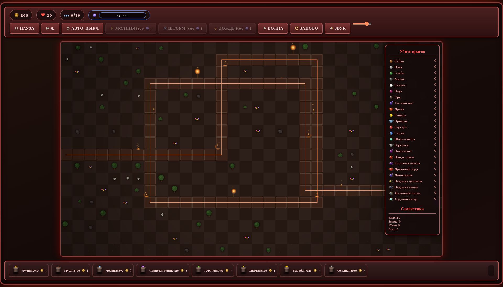

# Tower Defence — «Цитадель Орды»

Браузерная tower defence игра в стиле дарк-фентези Warcraft III. Vanilla JavaScript, рендер на canvas, ни сборки, ни внешних зависимостей. Разметка — `index.html`, стили — `css/style.css`, логика — `js/game.js`.



## Запуск

1. Склонировать репозиторий.
2. Открыть `index.html` в браузере (двойной клик) — всё, можно играть.

Игра работает полностью офлайн: шрифты лежат в репозитории (`assets/fonts/`, лицензия SIL OFL — см. `assets/fonts/LICENSE.md`).

## Управление

| Действие | Управление |
| --- | --- |
| Построить башню | Кнопка башни внизу → клик по клетке |
| Выбрать башню | Клик по ней |
| Отменить постройку | Правый клик или `Esc` |
| Улучшить выбранную башню | `U` |
| Начать волну | `Space` или кнопка «Волна» |
| Пауза / меню паузы | `Esc` или кнопка «Пауза» |
| Рестарт после конца игры | `R` |

Плюс кнопки скорости (×1/×2), авто-старта волн, звука и ползунок громкости.

## Что в игре

- **8 башен**, у каждой 4 уровня прокачки: Лучник (быстрые выстрелы, на 4 уровне — мультивыстрел), Пушка (урон по площади, не достаёт летающих), Ледяная (замедление), Чернокнижник (магический урон), Алхимик (яд с уроном по времени), Шаман (цепная молния), Барабан (не атакует, усиливает соседние башни), Осадная (пробивает броню, не достаёт летающих). Продажа возвращает 40% вложенного.
- **16 видов врагов и 8 боссов** со способностями: невидимость, неуязвимость, щит урона, аура ускорения союзников, берсерк (ускорение при низком HP), лечение союзников. Броня и сопротивления — у разных типов по-разному.
- **Летающие враги** (Мышь, Дрейк, Горгулья, Драконий лорд, Ходячий ветер) — идут паря над дорогой, Пушка и Осадная не могут их целить.
- **30 волн** с нарастающей сложностью; боссы — с 5-й волны. С 6-й волны действуют модификаторы по кругу: Ураган, Панцирь, Регенерация, Барьер, Ночь, Туман.
- **3 заклинания на мане**: Молния (300), Шторм (400), Дождь (500). Мана копится во время волны и тратится между ними.
- **Статистика**: мультиборд убийств по каждому типу врагов, итоговый экран победы/поражения со счётом, временем, волнами и жизнями.
- **Автосохранение** прогресса в localStorage — можно закрыть вкладку и продолжить позже.
- **Звук** на Web Audio API без аудиофайлов: процедурный синтез с шумовыми слоями, фильтрами с огибающими и компрессором на мастере (выстрелы, взрывы, спеллы, фанфары).
- **Процедурные спрайты**: все существа и башни рисуются кодом на offscreen-канвах при загрузке в двойном разрешении, ни одной картинки в репозитории.

## Структура репозитория

```
index.html                       — разметка страницы, подключает стили и скрипт
css/style.css                    — все стили игры
css/fonts.css                    — локальные @font-face (кириллица + латиница)
js/game.js                       — вся игровая логика
assets/fonts/                    — шрифты Grenze Gotisch, Ruslan Display, Cormorant (OFL)
assets/sprites/                  — папка под будущие спрайты
assets/sounds/                   — папка под будущие звуки
docs/                            — скриншот и метафайлы разработки
dev/                             — рабочая копия версии в разработке
Archive/                         — архивные версии (ничего не удаляем)
scripts/                         — скрипты обработки (шрифты, разделение, рендер, звук)
td-project-description.md        — подробное техническое описание механик
```

## Технические детали

- Canvas 1792×1008 (логика), физический буфер ×2 на HiDPI-экранах; спрайты рендерятся в двойном разрешении.
- Чистый JS (IIFE), без фреймворков, сборщиков и зависимостей.
- Шрифты с поддержкой кириллицы: Ruslan Display (заголовки, кнопки), Cormorant Unicase (акценты), Cormorant (текст), Grenze Gotisch (латиница).
- Состояние сейва: золото, жизни, волна, мана, башни, статистика, скорость, громкость — ключ `td_save` в localStorage.
- Разделение монолита на файлы выполнено скриптом `scripts/split_game.js`; оригинал хранится в `Archive/`.

## Планы

- [ ] Дополнительные визуальные улучшения: прорисовка пути, эффекты снарядов
- [ ] Расчистка дубликатов: `dev/` и `Archive/` сейчас повторяют `index.html` байт в байт
- [ ] Рефакторинг: вынести баланс (цены, урон, волны) в отдельный конфиг для быстрой настройки

---
Личный проект. Вопросы и идеи — через issues.
